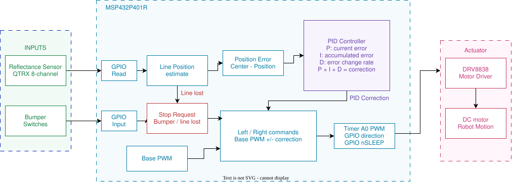

# ece528_final_project

## PID Line Follower Project Proposal

ECE 528/L Robotics and Embedded Systems | Fall 2026

## Objective

My goal is to learn how to implement and tune a PID controller using the TI-RSLK MAX line-following robot. I will reuse the existing lab hardware and compare its tracking on straight sections and gradual curves with the fixed-correction controller from Lab 3.

## Background and Methodology

I want to focus on the feedback algorithm and how tuning changes the robot's behavior. I will reuse the motor control, reflectance sensor, and periodic tasks from Labs 1-3 [1]. GPIO will read the sensors and bumper switches and control the motor direction and enable pins. Timer A0 will generate motor PWM, and Timer A1 will run periodic sampling and control with an empty main while loop. SysTick, UART, and the built-in LEDs will support timing and testing.

1. Study PID feedback and tuning using the MathWorks videos and TI-RSLK lecture [3-5]. Verify the existing sensors on a 1-inch black line.

2. Estimate line position from the active sensors and calculate the error from the center.

3. Implement PID in C. The proportional term uses the current error, the integral term uses accumulated error, and the derivative term uses how the error changes. Use the correction to adjust left and right motor PWM. Final gains and sampling timing will be selected during testing.

4. Compare both controllers on the same track over five runs each. Record completed runs, line losses, and completion time. Stop the motors if the line is lost or a bumper is pressed.

The expected outcome is smoother tracking with fewer line losses. Testing will focus on a continuous track with straight sections and gradual curves.

## Block Diagram

## Pinout Plan

The planned connections reuse the existing lab wiring [1].

| Function | MSP432 connection | 
|---|---|
| Reflectance sensor outputs 0-7 | P7.0-P7.7 |  
| Even IR emitter control | P5.3 | 
| Odd IR emitter control | P9.2 | 
| Left motor PWM | P2.7 / TA0.4 | P
| Right motor PWM | P2.6 / TA0.3 |
| Left motor direction | P5.4 | 
| Right motor direction | P5.5 | 
| Left motor wake (nSLEEP) | P3.7 | 
| Right motor wake (nSLEEP) | P3.6 | 
| Bumper switches | P4.0, P4.2, P4.3, P4.5, P4.6, P4.7 | 
| Red status LED | P1.0 | 
| RGB status LED | P2.0-P2.2 | 
| USB serial diagnostics | P1.2 RX / P1.3 TX | 
| Sensor power and common ground | 5V / GND | 

## Components Used

- TI-RSLK MAX chassis and MSP432P401R LaunchPad

- 8-channel QTRX reflectance sensor array

- Two DC motors, existing motor drivers, bumper switches, and built-in LEDs

- Battery pack, USB cable, 1-inch black tape, and a white track surface

- Computer with Code Composer Studio, C firmware, and the existing lab drivers

## References

[1] A. Nanas, ECE 528/L Labs 1-3: Motor Control, Reflectance Sensor, and Line Follower, Fall 2026.

[2] ECE 528/L Final Project Guidelines, Fall 2026.

[3] B. Douglas, "What Is PID Control? | Understanding PID Control, Part 1," MathWorks, May 31, 2018. [Online video]. [Watch video](https://www.mathworks.com/videos/understanding-pid-control-part-1-what-is-pid-control--1527089264373.html).

[4] B. Douglas, "A PID Tuning Guide | Understanding PID Control, Part 4," MathWorks, July 9, 2018. [Online video]. [Watch video](https://www.mathworks.com/videos/understanding-pid-control-part-4-a-pid-tuning-guide-1531124725727.html).

[5] Texas Instruments, "TI-RSLK Module 17 - Lecture video - Control systems," Oct. 17, 2017. [Online video]. [Watch video](https://www.ti.com/video/5615458906001).

